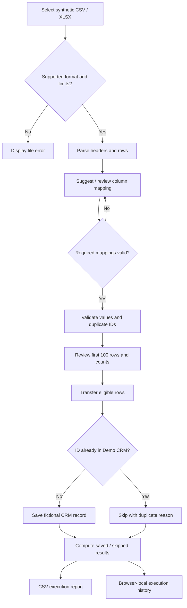
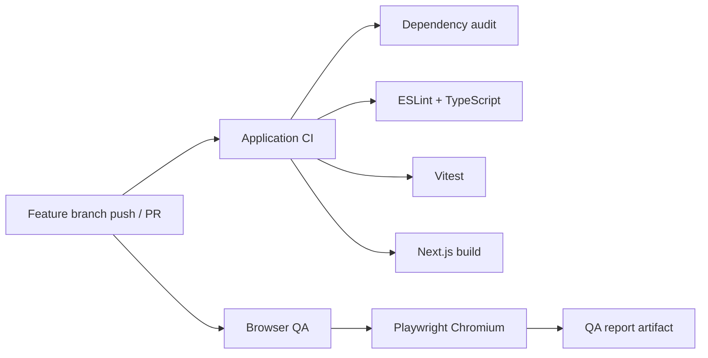
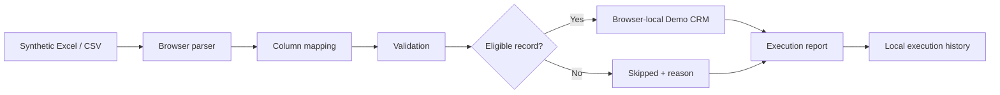

# FlowBridge AI

**Spreadsheet-to-web workflow automation — portfolio demo and RPA prototype**

FlowBridge AI demonstrates how structured CSV/XLSX data can be mapped, validated, transferred into a fictional CRM, and tracked through execution reports. The current application operates **locally in the user's browser**. Playwright UI automation exists as test prototypes; a reusable background worker for third-party portals is **not yet integrated**.

> **Demo only:** Use fictional/synthetic records. Do not upload personal, confidential, financial, or production customer data.

## At a glance

| | |
|---|---|
| **Product type** | Portfolio demonstration of data validation, browser-local transfer and RPA concepts |
| **Current environment** | Next.js application hosted on Vercel preview |
| **Supported files** | `.csv`, `.xlsx` |
| **Maximum input** | 2 MB and 1,000 rows per file |
| **Preview limit** | First 100 mapped rows |
| **Data destination** | Fictional Demo CRM in the same browser |
| **History retention** | Up to 20 execution entries in localStorage |
| **Test automation** | Vitest + Playwright Chromium CI |
| **Production readiness** | Not production-ready; real portal automation is future work |

## End-to-end example: 10 synthetic records

A user prepares a spreadsheet containing ten fictional customer requests and imports it into Smart Import.

| Stage | User action | Expected result |
|---|---|---|
| 1. Select | Choose `demo-requests.xlsx` | Browser reads the workbook; no server upload |
| 2. Map | Match source columns to six destination fields | Required mappings must be complete |
| 3. Validate | Review ten valid rows | Invalid and within-file duplicate IDs are identified |
| 4. Transfer | Select **Transfer valid rows to Demo CRM** | Ten new eligible records are saved locally |
| 5. Verify | Open Demo CRM | Ten new records appear alongside any existing demo records |
| 6. Review | Open Execution History | Run summary and record-level results are available |
| 7. Re-run | Import the identical file again | Previously saved IDs are skipped instead of duplicated |
| 8. Export | Download the CSV execution report | Each processed row includes its result and reason |

This is an **illustrative expected scenario**, not a guarantee of every file's results. The reported success rate is the share of processed rows saved in that run; a re-run with zero saved can be expected when all records already exist.

### Example CSV input

```csv
recordId,customerName,email,phone,description,date
FLOW-101,Avery Sample,avery@example.com,5550101,Demo service request,2026-10-20
FLOW-102,Jordan Demo,jordan@example.com,5550102,Demo follow-up request,2026-10-21
```

Use invented data only. The email addresses and phone numbers above are illustrative and must not be used to contact anyone.

## Validation and duplicate-handling rules

| Check | Behavior |
|---|---|
| Missing required value | Record cannot be saved; reason shown |
| Date | Must be a real calendar date in `YYYY-MM-DD` format |
| Email | Validates the format when supplied |
| Duplicate record ID in uploaded file | Identified during validation |
| Record ID already present in Demo CRM | Skipped during transfer |
| Invalid or malformed spreadsheet | Displays a parsing/validation error |
| Unsupported extension | Only CSV/XLSX accepted |
| Too-large file or too many rows | Rejected according to demo limits |

**Important distinction:** Duplicate IDs found within the uploaded file are different from IDs already stored in the CRM. The mapped preview primarily shows file-level validation; the transfer report also explains destination duplicates.

## Detailed process and decision flow



## Repository guide

```text
FlowBridge-AI/
├── README.md                    # Project introduction and quick start
├── docs/
│   ├── architecture.md          # Components, sequence diagrams, boundaries
│   ├── product-workflow.md      # Business scenarios and workflow roadmap
│   ├── qa-strategy.md           # Testing, coverage, release checklist
│   └── worker-design.md         # Future worker specification
├── src/
│   ├── app/
│   │   ├── page.tsx             # Homepage
│   │   ├── import/page.tsx      # Smart Import UI
│   │   ├── demo-crm/page.tsx    # Fictional CRM
│   │   ├── history/page.tsx     # Execution history
│   │   └── globals.css          # Responsive visual styles
│   └── lib/
│       ├── spreadsheet.ts       # File parsing
│       ├── mapping.ts           # Column mapping
│       ├── records.ts           # Data validation
│       ├── transfer.ts          # Browser-local transfer decisions
│       ├── demo-crm.ts          # CRM model and storage
│       ├── execution-report.ts  # Statistics and CSV reports
│       └── execution-history.ts # Local history management
├── e2e/                         # Playwright browser tests and prototypes
└── .github/workflows/
    ├── ci.yml                   # Lint, types, unit tests, build, audit
    └── browser-qa.yml           # Chromium end-to-end suite
```

## UI and user experience

The interface is designed around a short operator workflow: upload, map, review, transfer, verify, and report. It uses a responsive dark theme, labeled form controls, keyboard focus indicators, metric cards, scrollable result tables, and separate pages for CRM records and execution history.

The UI currently offers **saved/skipped summaries**, not a live browser-worker progress monitor. Mobile/tablet smoke tests exist; comprehensive accessibility and cross-browser certification remain outstanding.

## How the test pipeline works



The application CI and Browser QA are independent GitHub Actions workflows. **Both must pass on the relevant commit** before calling that commit regression-tested. CI does not merge the branch or publish the application to Production.

## Frequently asked questions

**Does FlowBridge automate third-party websites today?**  
No. The current import transfers to a fictional CRM in browser storage. Playwright scripts demonstrate browser form entry in tests, but Smart Import does not dispatch them as jobs.

**Is my uploaded file sent to a server?**  
The current parser reads files in the browser. The resulting fictional records and reports can be stored locally in that browser. Avoid uploading real or confidential data regardless.

**Why were all records skipped on my second import?**  
If the same IDs were saved previously, duplicate protection skips them. Inspect each reason in the execution report.

**Will my records be visible on another device?**  
No. This demo has no shared database; localStorage belongs to the browser and origin.

**What happens if I clear execution history?**  
The history list is removed, but Demo CRM records are preserved. Resetting CRM data is a separate action.

**Can I use FlowBridge with my company's portal?**  
Not yet. Any future integration needs authorization, approved destinations, authentication, secure credentials, verification, and operational safeguards.

**Is this open source?**  
The repository's visibility does not by itself grant reuse rights. No license is declared in this README.

## Future commercial direction

FlowBridge could evolve into a managed automation offering for teams repeatedly entering structured records into approved web portals. Potential models include implementation fees, subscription by workflow or usage, and managed support. These are **business hypotheses**, not launched pricing plans or customer commitments.

A future MVP should demonstrate a complete authorized browser execution, reliable verification, safe retry rules, auditability, and operator visibility before making time-saving or accuracy claims.

## What problem does it address?

Operations teams often copy rows from spreadsheets into web applications one record at a time. This introduces repetitive work, errors, duplicate entries, and limited visibility into what was completed. FlowBridge explores a workflow for preparing and validating data before automation and recording per-record results.

## Who is it for?

- Small businesses moving spreadsheet leads into CRM tools
- Field-service and construction operations entering job requests into portals
- Recruitment teams preparing candidate records for applicant tracking systems
- Logistics and BPO teams performing authorized repetitive portal entry

These are **potential customers/use cases**, not existing commercial integrations.

## What works today?

| Feature | Status | Notes |
|---|---|---|
| CSV and XLSX upload | Implemented | Parsed client-side; max 2 MB / 1,000 rows |
| Source-to-target column mapping | Implemented | Suggestions plus manual mapping |
| Data validation | Implemented | Required fields, dates, email format, duplicate IDs |
| Fictional Demo CRM | Implemented | Records stored in browser localStorage |
| Execution reports | Implemented | Per-record saved/skipped outcomes and CSV export |
| Execution history | Implemented | Last 20 runs, browser-local |
| Browser form automation | Test prototype | Playwright drives the fictional CRM in QA tests |
| Background Playwright worker | Planned | Not connected to Smart Import |
| External portal connectors | Planned | No live client portals |
| Accounts, database, billing | Planned | Not part of this demo |

## Try the demo

1. Open **Smart Import** at `/import`.
2. Upload a **synthetic** `.csv` or `.xlsx` file (max 2 MB, 1,000 records).
3. Check suggested field mappings and fix any mismatches.
4. Review valid, invalid, and duplicate records.
5. Select **Transfer valid rows to Demo CRM**.
6. Open **Demo CRM** (`/demo-crm`) to review saved records.
7. Open **Execution History** (`/history`) to download per-run CSV reports.
8. Upload the same file again to see existing record IDs skipped.

**Expected target fields:** `recordId`, `customerName`, `email`, `phone`, `description`, `date`. Required: record ID, customer name, description, and ISO date (`YYYY-MM-DD`).

## Current workflow



**No Playwright worker runs when you click Transfer.** The current transfer is a browser-local operation.

## Technology stack

| Layer | Technology | Purpose |
|---|---|---|
| Language | TypeScript 5.9 | Typed application and test code |
| Framework | Next.js 15.5, React 19 | UI and routing |
| Styling | CSS | Responsive dark interface and focus states |
| Excel parsing | `read-excel-file` | Browser-side XLSX import |
| CSV parsing | Papa Parse | Browser-side CSV import |
| Test fixture generation | ExcelJS (development) | Synthetic XLSX files in automated tests |
| Unit tests | Vitest | Mapping, validation, transfer, reports |
| Browser QA | Playwright (Chromium CI) | UI, import, history, responsive and keyboard smoke checks |
| Automation / CI | GitHub Actions | Lint, typecheck, tests, build, dependency audit |
| Hosting | Vercel | Preview deployments |
| Demo storage | Browser `localStorage` | Fictional CRM and run history |

`zod` is listed as a project dependency; this README does not claim it is currently used for all validation.

## Run locally

Requirements: Node.js 22 and npm.

```bash
git clone https://github.com/ganesh2412/FlowBridge-AI.git
cd FlowBridge-AI
git checkout feature/flowbridge-foundation
npm install
npm run dev
```

Open http://localhost:3000.

### Quality checks

```bash
npm run lint
npm run typecheck
npm test
npm run build
npx playwright install chromium
npm run test:e2e
npm audit --omit=dev --audit-level=high
```

GitHub Actions runs CI and Chromium browser tests. A green CI run does not establish Safari or Firefox compatibility; those require separate verification.

## Architecture and security boundaries

Current: Next.js UI → client-side parser/mapping/validation → browser-local CRM and execution history. **No server-side database, worker queue, third-party portal connection, or credential vault.**

For future customer automation, the design calls for an authenticated job API, isolated worker, destination allowlist, securely managed credentials, audit trail, human approval, save verification, and safe retry/idempotency rules. Never bypass access controls, CAPTCHA, or MFA.

## Documentation

- [Product overview, customers and business workflows](docs/product-workflow.md)
- [Technical architecture and diagrams](docs/architecture.md)
- [QA strategy and test coverage](docs/qa-strategy.md)
- [Future automation-worker design](docs/worker-design.md)

## Roadmap

1. Finalize browser compatibility, security and accessibility review.
2. Define an approved-destination worker contract and job lifecycle.
3. Connect validated synthetic imports to an isolated Playwright worker.
4. Add verifiable record outcomes, controlled retries and exception review.
5. Validate a supervised, authorized customer pilot before commercial release.

## Project status

**Portfolio demo / experimental prototype — not production-ready SaaS.** The project is developed on `feature/flowbridge-foundation`; do not assume the preview branch is merged to `main`.

## License and contributions

No open-source license is asserted here. Contact the repository owner before reusing the code. Issues and feedback are welcome through GitHub.
