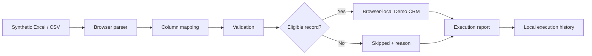

# FlowBridge AI

**Spreadsheet-to-web workflow automation — portfolio demo and RPA prototype**

FlowBridge AI demonstrates how structured CSV/XLSX data can be mapped, validated, transferred into a fictional CRM, and tracked through execution reports. The current application operates **locally in the user's browser**. Playwright UI automation exists as test prototypes; a reusable background worker for third-party portals is **not yet integrated**.

> **Demo only:** Use fictional/synthetic records. Do not upload personal, confidential, financial, or production customer data.

## What problem does it address?

Operations teams often copy rows from spreadsheets into web applications one record at a time. This introduces repetitive work, errors, duplicate entries, and limited visibility into what was completed. FlowBridge explores a workflow for preparing and validating data before automation and recording per-record results.

## Who is it for?

- Small businesses moving spreadsheet leads into CRM tools
- Field-service and construction operations entering job requests into portals
- Recruitment teams preparing candidate records for applicant tracking systems
- Logistics and BPO teams performing authorized repetitive portal entry

These are **potential customers/use cases**, not existing commercial integrations.

## What works today?

| Feature | Status | Notes |
|---|---|---|
| CSV and XLSX upload | Implemented | Parsed client-side; max 2 MB / 1,000 rows |
| Source-to-target column mapping | Implemented | Suggestions plus manual mapping |
| Data validation | Implemented | Required fields, dates, email format, duplicate IDs |
| Fictional Demo CRM | Implemented | Records stored in browser localStorage |
| Execution reports | Implemented | Per-record saved/skipped outcomes and CSV export |
| Execution history | Implemented | Last 20 runs, browser-local |
| Browser form automation | Test prototype | Playwright drives the fictional CRM in QA tests |
| Background Playwright worker | Planned | Not connected to Smart Import |
| External portal connectors | Planned | No live client portals |
| Accounts, database, billing | Planned | Not part of this demo |

## Try the demo

1. Open **Smart Import** at `/import`.
2. Upload a **synthetic** `.csv` or `.xlsx` file (max 2 MB, 1,000 records).
3. Check suggested field mappings and fix any mismatches.
4. Review valid, invalid, and duplicate records.
5. Select **Transfer valid rows to Demo CRM**.
6. Open **Demo CRM** (`/demo-crm`) to review saved records.
7. Open **Execution History** (`/history`) to download per-run CSV reports.
8. Upload the same file again to see existing record IDs skipped.

**Expected target fields:** `recordId`, `customerName`, `email`, `phone`, `description`, `date`. Required: record ID, customer name, description, and ISO date (`YYYY-MM-DD`).

## Current workflow



**No Playwright worker runs when you click Transfer.** The current transfer is a browser-local operation.

## Technology stack

| Layer | Technology | Purpose |
|---|---|---|
| Language | TypeScript 5.9 | Typed application and test code |
| Framework | Next.js 15.5, React 19 | UI and routing |
| Styling | CSS | Responsive dark interface and focus states |
| Excel parsing | `read-excel-file` | Browser-side XLSX import |
| CSV parsing | Papa Parse | Browser-side CSV import |
| Test fixture generation | ExcelJS (development) | Synthetic XLSX files in automated tests |
| Unit tests | Vitest | Mapping, validation, transfer, reports |
| Browser QA | Playwright (Chromium CI) | UI, import, history, responsive and keyboard smoke checks |
| Automation / CI | GitHub Actions | Lint, typecheck, tests, build, dependency audit |
| Hosting | Vercel | Preview deployments |
| Demo storage | Browser `localStorage` | Fictional CRM and run history |

`zod` is listed as a project dependency; this README does not claim it is currently used for all validation.

## Run locally

Requirements: Node.js 22 and npm.

```bash
git clone https://github.com/ganesh2412/FlowBridge-AI.git
cd FlowBridge-AI
git checkout feature/flowbridge-foundation
npm install
npm run dev
```

Open http://localhost:3000.

### Quality checks

```bash
npm run lint
npm run typecheck
npm test
npm run build
npx playwright install chromium
npm run test:e2e
npm audit --omit=dev --audit-level=high
```

GitHub Actions runs CI and Chromium browser tests. A green CI run does not establish Safari or Firefox compatibility; those require separate verification.

## Architecture and security boundaries

Current: Next.js UI → client-side parser/mapping/validation → browser-local CRM and execution history. **No server-side database, worker queue, third-party portal connection, or credential vault.**

For future customer automation, the design calls for an authenticated job API, isolated worker, destination allowlist, securely managed credentials, audit trail, human approval, save verification, and safe retry/idempotency rules. Never bypass access controls, CAPTCHA, or MFA.

## Documentation

- [Product overview, customers and business workflows](docs/product-workflow.md)
- [Technical architecture and diagrams](docs/architecture.md)
- [QA strategy and test coverage](docs/qa-strategy.md)
- [Future automation-worker design](docs/worker-design.md)

## Roadmap

1. Finalize browser compatibility, security and accessibility review.
2. Define an approved-destination worker contract and job lifecycle.
3. Connect validated synthetic imports to an isolated Playwright worker.
4. Add verifiable record outcomes, controlled retries and exception review.
5. Validate a supervised, authorized customer pilot before commercial release.

## Project status

**Portfolio demo / experimental prototype — not production-ready SaaS.** The project is developed on `feature/flowbridge-foundation`; do not assume the preview branch is merged to `main`.

## License and contributions

No open-source license is asserted here. Contact the repository owner before reusing the code. Issues and feedback are welcome through GitHub.
