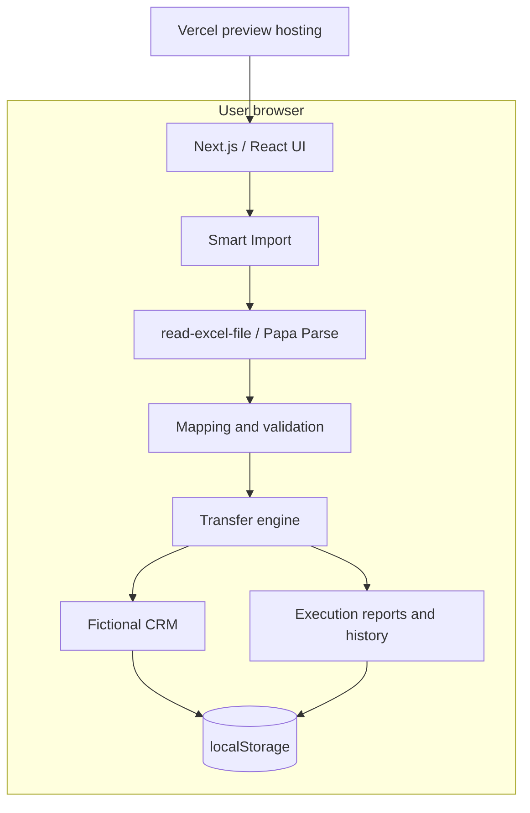
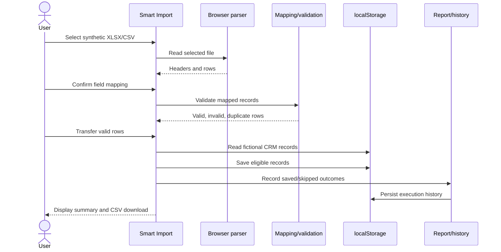
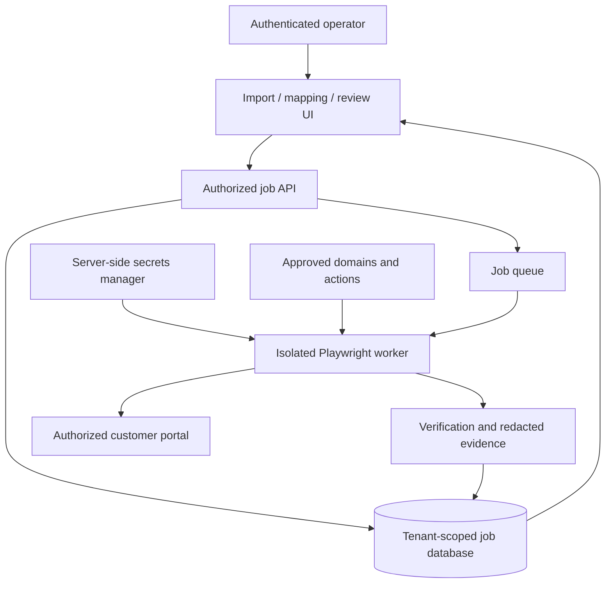
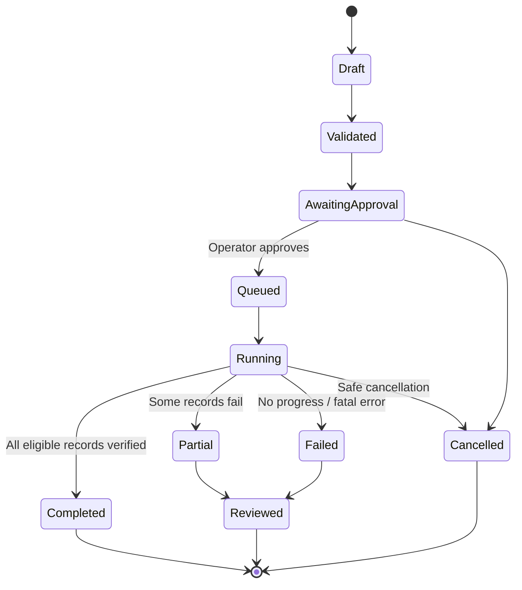

# Technical architecture and data flow

## Scope and status

This document distinguishes the **implemented browser-local demo** from a **proposed hosted RPA architecture**. No production Playwright worker, job queue, database, authentication system, or external portal connector is deployed.

## Implemented component diagram



### Application routes

| Route | Responsibility |
|---|---|
| `/` | Product overview and navigation |
| `/import` | File selection, mapping, validation, transfer, report |
| `/demo-crm` | Fictional CRM entry, search, saved records, reset |
| `/history` | Last 20 browser-local execution summaries and downloads |

### Important modules

| File | Responsibility |
|---|---|
| `src/lib/spreadsheet.ts` | CSV/XLSX parsing and row/header checks |
| `src/lib/mapping.ts` | Field suggestions, mapping validation and application |
| `src/lib/records.ts` | Required fields, dates, email format and duplicate checks |
| `src/lib/demo-crm.ts` | Fictional CRM records and storage schema |
| `src/lib/transfer.ts` | Save/skip decisions and outcome generation |
| `src/lib/execution-report.ts` | Summary statistics and CSV export |
| `src/lib/execution-history.ts` | Local execution history, capped at 20 |
| `src/app/globals.css` | Global visual styles and responsive behavior |

### Sequence: current demo



### Data model

```typescript
type SourceRecord = {
  recordId: string;
  customerName: string;
  email: string;
  phone: string;
  description: string;
  date: string; // YYYY-MM-DD
};
type TransferOutcome = {
  row: number;
  recordId: string;
  status: 'saved' | 'skipped';
  reason: string;
};
```

Required fields are `recordId`, `customerName`, `description` and `date`. Duplicates within the file and already present in the demo CRM are handled as skipped outcomes. Report success rate = saved / total processed × 100.

### Storage and limitations

- Spreadsheet parsing happens in the browser; the selected file is not uploaded by this demo.
- Demo CRM and execution history are stored in `localStorage`, not shared across browsers/devices.
- History retains up to 20 entries; clearing history does not clear CRM data.
- Browser storage is not suitable for sensitive customer data or durable enterprise workflows.
- Upload limits: 2 MB and 1,000 rows. Record preview shows up to 100 rows.
- Preview deployments may be protected by Vercel authentication.

## Proposed worker architecture — NOT IMPLEMENTED



### Proposed job lifecycle



The future worker must verify each destination save before reporting success, prevent duplicate submissions with idempotency keys, restrict retries to known-safe actions, support operator cancellation, and redact sensitive data in logs.

## Security principles

1. Only automate systems with explicit customer authorization.
2. Prefer an official API or import mechanism when available.
3. Do not bypass login protections, CAPTCHA, MFA, rate limits, or portal terms.
4. Store credentials server-side in an appropriate secret manager, never in browser storage.
5. Implement tenant isolation, least privilege, allowed destination domains, and auditable approval.
6. Set data-retention and deletion policies before any real customer pilot.
7. Separate preview/test data from any real customer environment.

## Deployment and quality gates

GitHub Actions `ci.yml` runs npm install, production dependency audit at high severity, ESLint, TypeScript, Vitest, and Next.js build. `browser-qa.yml` installs Chromium, runs Playwright E2E, and uploads a report artifact. Vercel hosts previews; CI passing does not prove production readiness.

See [QA strategy](qa-strategy.md), [worker design](worker-design.md), and [product workflow](product-workflow.md).
