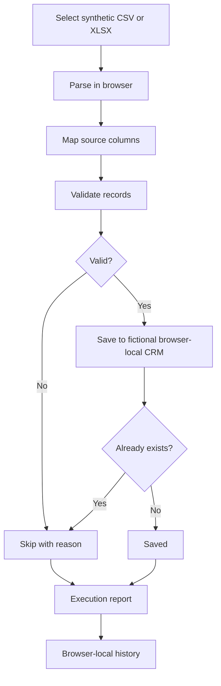
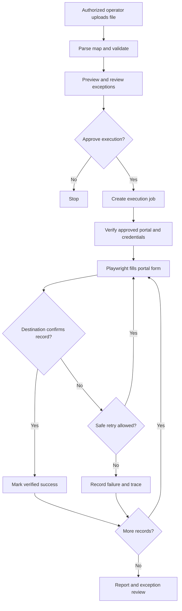

# FlowBridge AI — Product and Workflow

**Status:** Portfolio demo and Playwright browser automation prototype. Not production ready.

## Problem
Teams manually copy structured Excel/CSV records into web portals that lack usable bulk import or API integrations. FlowBridge aims to reduce this repetitive work while keeping validation, verification, and per-record outcomes visible.

## Primary customers
| Buyer | User | Example |
|---|---|---|
| SMB operations manager | Sales/operations coordinator | Spreadsheet leads into CRM |
| Field-service business owner | Dispatch coordinator | Job sheets into work-order portal |
| Recruitment agency owner | Recruiting coordinator | Candidate lists into ATS |
| Logistics manager | Dispatch staff | Shipment records into carrier portals |
| BPO delivery manager | Process operator | Repeated entry into client-approved portals |

**Initial market hypothesis:** SMB and service operations teams handling repeated spreadsheet-to-portal entry where no appropriate native import exists. Validate willingness to pay through interviews and a supervised pilot.

## Current capabilities
- CSV and XLSX browser-side import with file and row limits.
- Column mapping, required-field/date/email/duplicate validation.
- Synthetic records transferred to a fictional browser-local CRM.
- Saved/skipped outcomes, downloadable CSV report and browser-local history.
- Playwright tests performing actual UI form entry against fictional CRM, including duplicate rejection and batch prototype.
- CI, browser QA, responsive and accessibility smoke tests.

**Important:** Smart Import currently saves records to localStorage; it does not invoke a production Playwright worker. Playwright browser automation is implemented as test prototypes.

## Current demo workflow

## Planned browser-worker workflow

## Example
An operator receives 100 fictional customer requests. They upload the spreadsheet, map columns, inspect invalid/duplicate records and approve an execution. A future Playwright worker would enter eligible records in an approved portal, verify saves, and produce a report. **The approved-portal execution step is planned, not currently implemented in the app.**

## Business models to validate
- Setup fee plus monthly maintenance per portal workflow.
- Subscription based on runs or record volume.
- Managed automation service for businesses that want setup and monitoring.

These are hypotheses, not established prices or proven demand.

## Safety and requirements before real customers
- Use only authorized systems; respect portal terms and rate limits.
- Prefer official APIs or import mechanisms when available.
- Never bypass MFA, CAPTCHA or access controls.
- Protect credentials with server-side secret storage, not localStorage.
- Provide user approval, domain allowlisting, tenant isolation, audit logs and data retention controls.
- Verify destination saves; use idempotency to avoid duplicates and safe retries.
- Do not put personal, confidential or production data into the public demo.

## Roadmap
1. Finish security, accessibility, edge-case and release-readiness QA.
2. Define worker job schema, approved destinations and execution controls.
3. Integrate Smart Import with an isolated Playwright worker and per-record verification.
4. Pilot one authorized low-risk workflow with a customer.
5. Add authentication, observability, billing and operational support if pilot validates demand.

## Discovery questions
1. Which industry and portal should be supported first?
2. How many records are entered each day and how much staff time is spent?
3. Does an official API or bulk import already exist?
4. Who approves submissions and handles portal authentication?
5. What constitutes verified success, and what happens on partial failures?
6. What security, privacy and retention rules apply?
7. What is the cost of manual work and errors today?

**Positioning:** FlowBridge AI aims to turn spreadsheet-to-portal work into a repeatable, verifiable workflow. Today it demonstrates the foundation with synthetic data.
