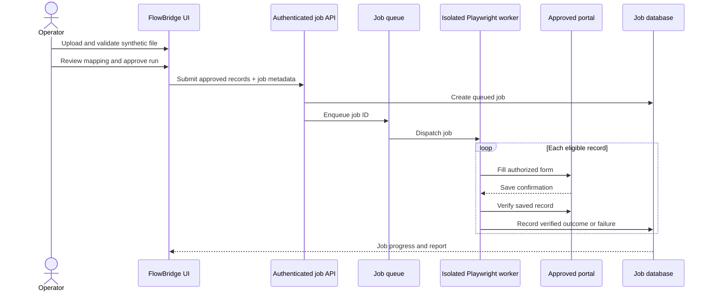

# Proposed Playwright worker — design specification

> **Future architecture. Not yet connected to Smart Import or deployed.**

## Purpose
Run approved, repeatable browser actions against a fictional CRM first, then evaluate a single authorized real-world portal with human supervision. Current Smart Import uses browser-local storage; Playwright automation exists in E2E tests only.

## Proposed execution sequence



## Suggested worker contract (illustrative, not implemented)

```typescript
type JobRequest = {
  destinationId: string; // server-allowlisted destination
  approvedBy: string; // authenticated operator identity
  records: Array<{
    sourceRow: number;
    recordId: string;
    customerName: string;
    email: string;
    phone: string;
    description: string;
    date: string;
  }>;
};
type RecordExecution = {
  recordId: string;
  status: 'queued' | 'running' | 'verified' | 'skipped' | 'failed';
  attempts: number;
  reason?: string;
  verifiedAt?: string;
};
```

## Proposed safeguards
- Authentication and explicit approval before each job.
- Restrict destinations and operations through allowlists.
- Encrypt credentials server-side; never place them in job payloads or client-side storage.
- Limit concurrency and respect site policies.
- Require confirmation and read-after-write verification for success.
- Use stable idempotency keys to avoid double submissions.
- Retry only when safe; do not retry ambiguous submissions blindly.
- Redact screenshots and logs, set retention limits, and provide cancellation.
- Handle MFA/CAPTCHA through legitimate human-in-the-loop steps; never bypass controls.

## Delivery milestones
1. Define and unit-test job schemas, lifecycle and outcome events.
2. Build a local isolated worker against fictional CRM with no customer credentials.
3. Connect approved synthetic imports to worker through a minimal authenticated API.
4. Add per-record progress, verification, failure evidence and cancellation.
5. Complete threat modeling and an authorized supervised pilot.
6. Add tenant isolation, monitoring, billing and support only after demand validation.

## Acceptance criteria for a worker MVP
- An approved job can enter at least two synthetic records via actual browser UI.
- Duplicate IDs and invalid records are not submitted.
- Partial failure does not silently abort unrelated records.
- A record is marked successful only after destination verification.
- Refreshing the UI preserves job status in a durable backend.
- Operator can inspect failures and export an accurate execution report.
- Unauthorized destinations and unauthenticated submissions are rejected.

**Do not call the worker production-ready until these requirements are implemented and independently tested.**
